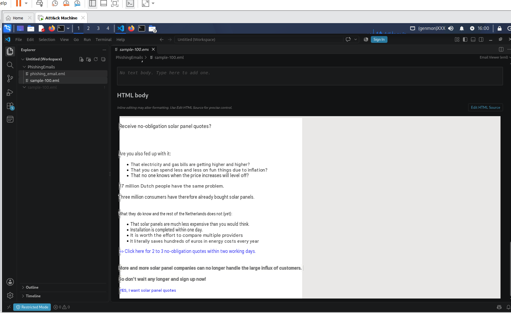
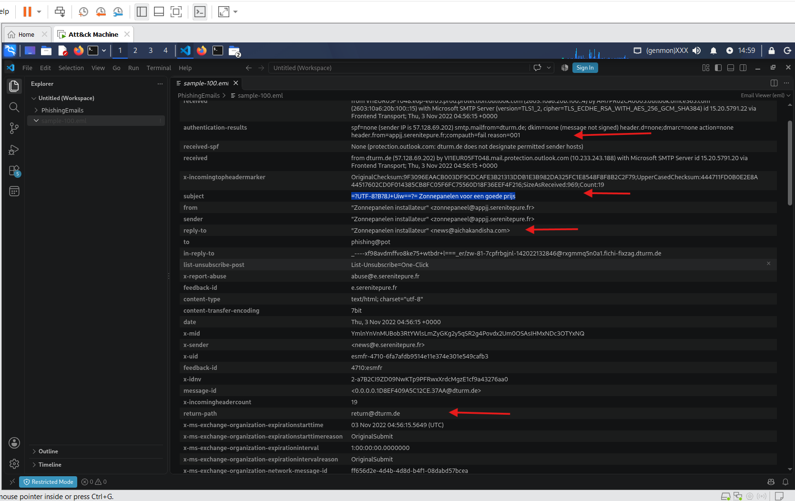
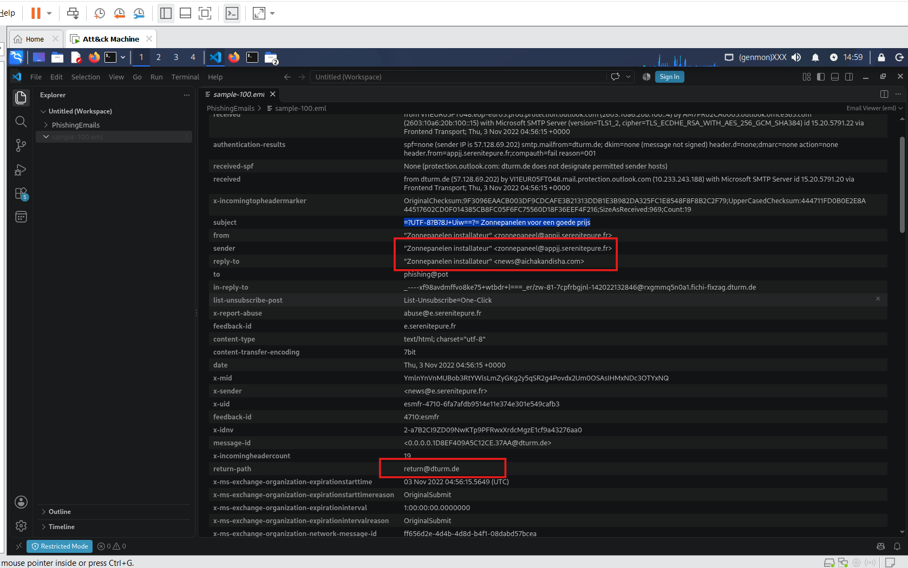
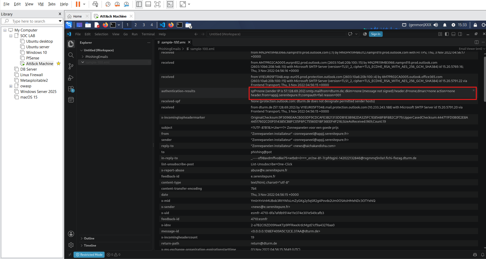
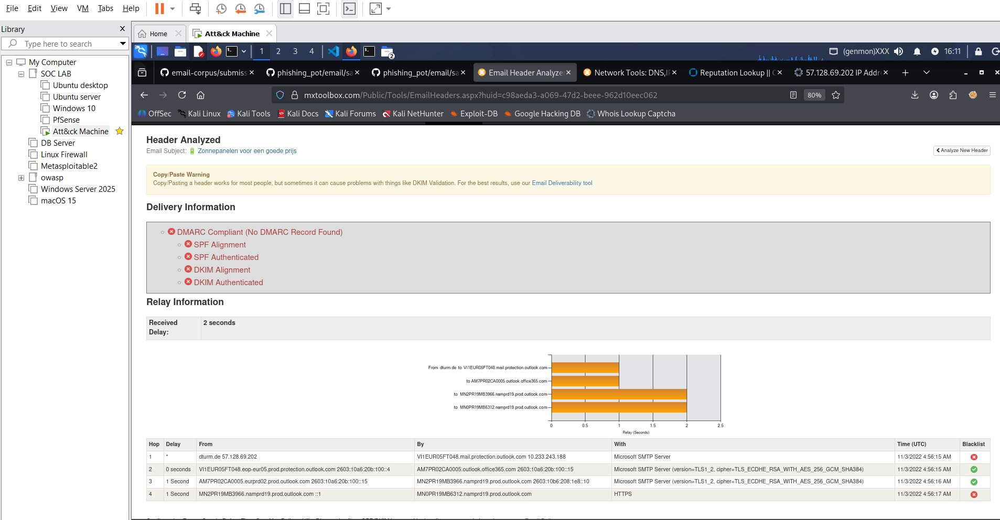
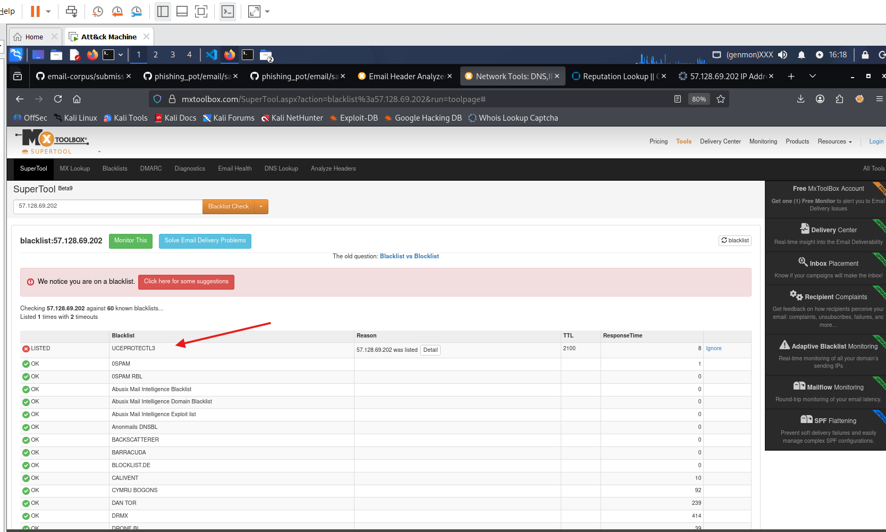
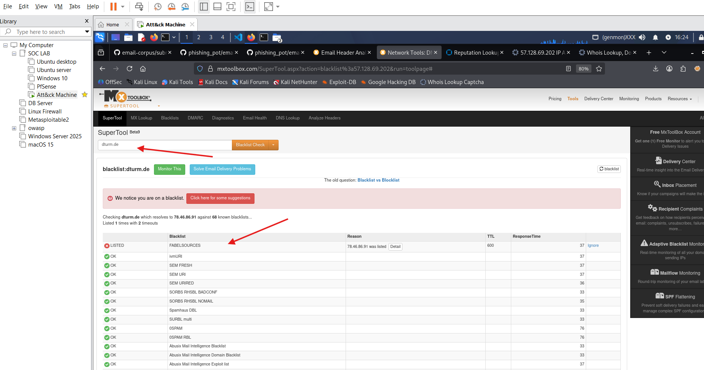
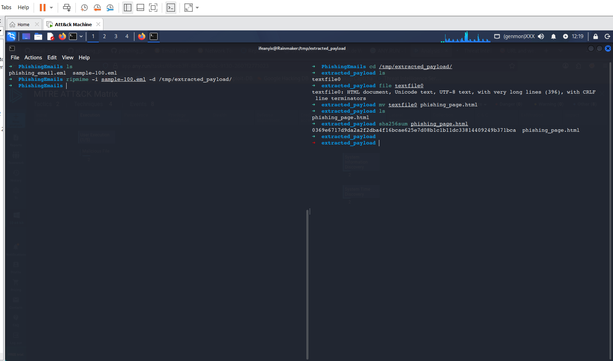
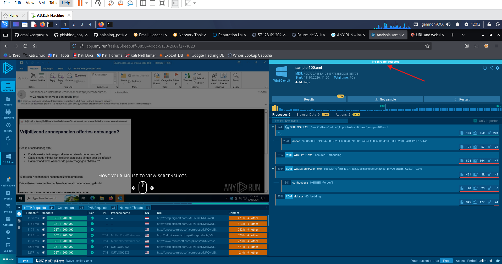

# Enterprise-Phishing-Triage-and-SOC-Incident-Response.

## Ingestion

### Alert Source
On Enterprise environment phising incident is generated by email security gateway like Microsoft Defender or reported by the end users but for this simulation , email is obtained from  [Phishing Pot](https://github.com/rf-peixoto/phishing_pot/blob/main/email/sample-100.eml) . 

 
 

    Figure 1: Translated Email body
 

### Evidence collection
The raw email .eml file format  is carefully downloaded into a restricted vmware linux workspace  for analysis and also previewed in vscode in a restricted mode.

### Initial Triage
An initial triage to understand intent of mail. The sender is financially motivated as seen in the email subject,"Solar Panel discount".

 
 

    Figure 2: Initial Triage 
 

## Header security Analysis

1. Identity verification:

    Visually comparing the Sender From address and the Return path for mismatches. The sender, return path and reply-to domain are mismatched indicating email spoofing.

    
 

     

                     Figure 3: Identity Mismatches
    

2. Validating the SPF, DKIM and DMARC;

SPF = None 
DKIM = None
DMARC = None

The sender intentionally tried to bypass security measures and this indicates a high probability of a phishing scam or malicious spoofing attempt.

 

        Figure 4: Validation Failures

3. Route History 
Analyzing the hop history, the email came from dturm.de with an Ip 57.128.69.202

  
 

    Figure 5: Header_Analysis and Routing History
 

4. Ip Reputation and Domain Lookup
Using threat intelligence feeds from Mxtoolbox shows the Ip and domain name are blacklisted.
 
 

    Figure 6: Ip reputation
 

 The ip is on blacklist

 
 

    Figure 7: Domain reputation check
 

 5. Attached Malware analysis
 attachments

 Using the ripmime tool to extract attachment and payloads from the .eml file into temporary folder and proceeded to get the file hash to avoid exposure of data. 

The file hash has returned no information, this could mean a zero day.
  
 

### Dynamic Analysis

    Figure 8: 
 

 Ran email in sandoxed cloud envirnoment to understand the behavior but no threat was detected.this could also mean a zeroday attack.
   
 

    Figure 9: Any run
 

### Key Findings

The indicators of compromise such as, Identity mismatches blacklisted ip and domain, lack and failure of auth validations such as SPF,DKIM,DMARC,intention and non expectance of email indicates a high probality of Phishing attempt via  use of social engineering tatics.

## Lesson Learned
Sophisticated cyber attacks often target human weakness especially through phishing. Experieced attackers often use tactics to bypass security measures such as the authetication validation bypass in this analysis. 

## Recommendation 
Verify the blast radius of email and user actions if they have clicked the link.
Disabling User ID, Escalation and 
Blocking of email ID on security email gateway and ip on firewall and security awareness training on phishing.

## Next Step
-  Mapping to Mittre attack Framework
- use of wireshark for packet analysis.

 

